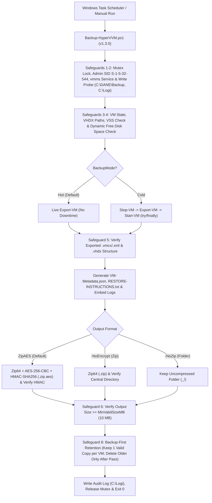
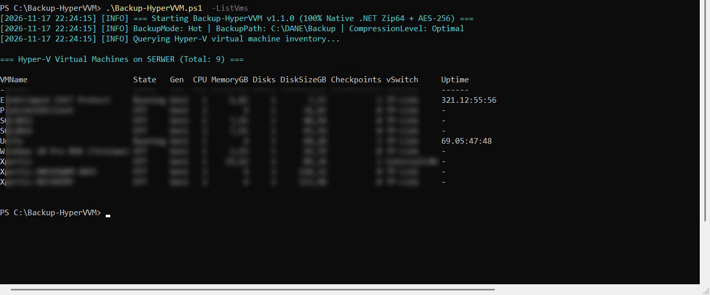
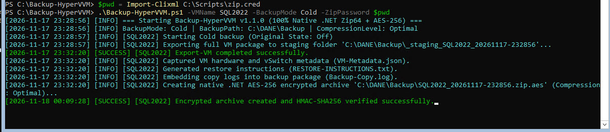
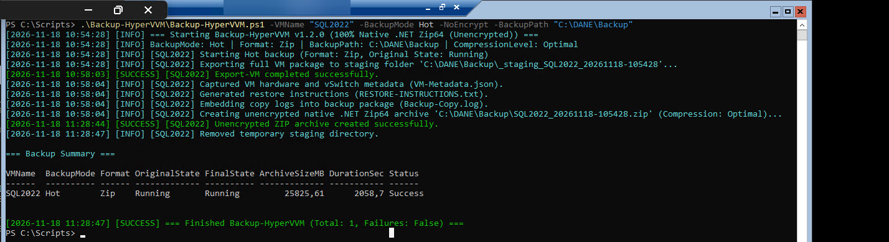
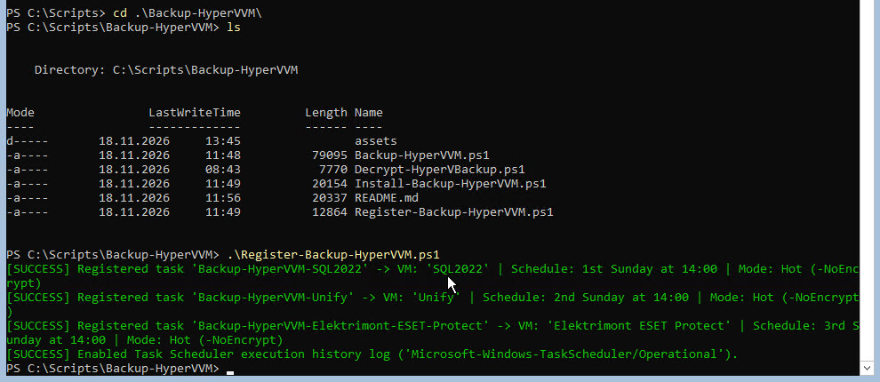
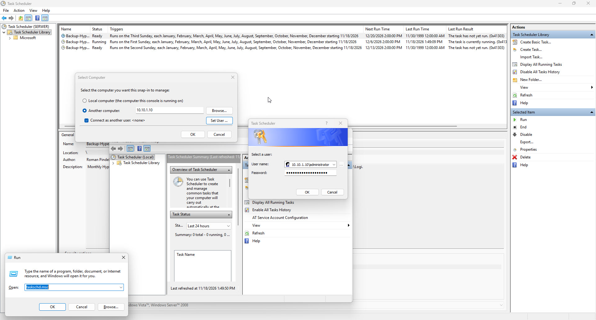
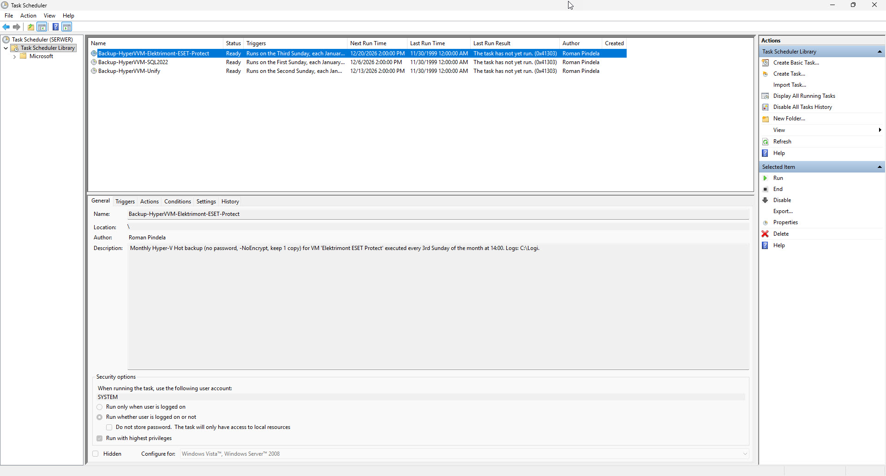

# Backup-HyperVVM

[](https://microsoft.com/powershell)
[](https://www.microsoft.com/windows-server)
[](https://github.com/romanpindela/Windows-Server)
[](https://opensource.org/licenses/MIT)

---

## Overview

`Backup-HyperVVM` is a **100% native Microsoft** PowerShell/.NET backup automation suite designed for **Windows Server Hyper-V hosts** (including Hyper-V Server Core without GUI; production deployment path: `C:\Scripts\Backup-HyperVVM\`). With **zero third-party dependencies**, it creates complete, self-contained backups of Hyper-V virtual machines in `C:\DANE\Backup` in **Hot** (live, zero-downtime, default) or **Cold** mode, writes execution audit logs to `C:\Logi`, enforces **8 multi-layered defensive safeguards**, and maintains **backup-first retention** (`-RetentionCount 1` by default — keeping only 1 verified copy per VM and deleting the older copy only after the new backup succeeds).

The suite includes:
- [`Backup-HyperVVM.ps1`](Backup-HyperVVM.ps1) — Core Hot/Cold backup engine with 8 defensive safeguards and retention guard.
- [`Install-Backup-HyperVVM.ps1`](Install-Backup-HyperVVM.ps1) — Automated interactive server installer (pre-flight Hyper-V/VM/disk checks, deployment to `C:\Scripts\Backup-HyperVVM\`, directory creation, and scheduled task setup).
- [`Register-Backup-HyperVVM.ps1`](Register-Backup-HyperVVM.ps1) — Dedicated Windows Task Scheduler registration script creating separate monthly Sunday tasks for `SQL2022`, `Unify`, and `Elektrimont ESET Protect` and enabling Task Scheduler history.
- [`Decrypt-HyperVBackup.ps1`](Decrypt-HyperVBackup.ps1) — Native .NET decryptor & extractor for AES-256 encrypted `.zip.aes` archives.

Three output formats are supported:
- **Encrypted ZIP (`ZipAES`, default):** Native .NET Zip64 compressed and encrypted with **AES-256-CBC + HMAC-SHA256** (`.zip.aes`).
- **Unencrypted ZIP (`-NoEncrypt`):** Native .NET Zip64 archive (`.zip`) with **no password** required.
- **Uncompressed Folder (`-NoZip`):** Direct Hyper-V export folder (`<VMName>_<timestamp>\`) with **no ZIP compression and no password**.

---

## Defensive Safeguards & Anti-Data-Loss Mechanisms

To prevent silent backup corruption, mid-export disk exhaustion, permission failures, or accidental deletion of the only healthy VM copy, `Backup-HyperVVM.ps1` enforces **8 multi-layered defensive safeguards**:

1. **Single-Instance Execution Lock (Global Named Mutex):**
   - Acquires an OS-level named Mutex (`Global\Backup-HyperVVM-Lock`) before starting VM exports.
   - Prevents overlapping executions (e.g., manual run colliding with a Windows Task Scheduler job) from saturating disk I/O or conflicting on staging/retention folders. Automatically handles abandoned mutexes if a prior process crashed.
2. **Administrator SID (`S-1-5-32-544`), Write/Delete Permission Probe, & `vmms` Service Check:**
   - Validates local Administrator rights via language-independent SID `S-1-5-32-544` (works identically on Polish/English Windows Server and under `NT AUTHORITY\SYSTEM`).
   - Verifies that the **Hyper-V Virtual Machine Management (`vmms`)** service is `Running` (and attempts recovery via `Start-Service` if stopped).
   - Performs an active **write/delete probe** (`.permtest_*.tmp`) on both `BackupPath` (`C:\DANE\Backup`) and `LogDir` (`C:\Logi`) before exporting any VM, ensuring NTFS/ACL permissions allow creating archives and running retention cleanup.
3. **Pre-Flight VM Existence, State, Disk Path, & VSS Integration Check:**
   - Confirms the target VM exists and is not in a blocked transient state (`Starting`, `Stopping`, `Saving`, `Pausing`, `Resuming`).
   - Validates every attached VHD/VHDX path on disk and sums the VM's total disk footprint.
   - In `Hot` mode on running VMs, checks the Hyper-V **VSS (Backup) Integration Service** status and logs a `[WARN]` if disabled so administrators know whether the live export is application-consistent or crash-consistent.
4. **Dynamic Pre-Flight Free Disk Space Verification (`-MinFreeSpaceMB 2048`):**
   - Calculates required free space dynamically on the target volume (`VM Disk Footprint + 2048 MB buffer`) before creating staging folders or running `Export-VM`.
   - Aborts cleanly upfront if free space is insufficient — preventing `Export-VM` from filling `C:` to 0 bytes and destabilizing the Hyper-V host. Also logs a `[WARN]` when `Zip`/`ZipAES` staging + archive headroom is below `1.5x VM size + buffer`.
5. **Post-Export Structural & VHDX Completeness Verification (`Test-ExportedVMPackage`):**
   - Immediately after `Export-VM` finishes, verifies that `<VMName>\Virtual Machines\` contains a non-empty `.vmcx`/`.xml` configuration file and (for VMs with disks) `<VMName>\Virtual Hard Disks\` contains non-empty `.vhdx`/`.vhd`/`.avhdx` files.
6. **Minimum Valid Backup Size Threshold (`-MinValidSizeMB 10`):**
   - Verifies that the final `.zip.aes`, `.zip`, or backup folder is at least **10 MB** (configurable via `-MinValidSizeMB`) whenever the VM has virtual disks attached.
   - Prevents empty or truncated archives from passing verification or triggering deletion of the previous healthy copy.
7. **Post-Creation Archive Integrity Verification:**
   - **`Zip` (`-NoEncrypt`):** Opens the `.zip` archive via `System.IO.Compression.ZipFile::OpenRead`, confirms non-zero entries, and verifies that core package entries (`VM-Metadata.json`, `RESTORE-INSTRUCTIONS.txt`, and `.vmcx`/`.xml`) exist in the Zip64 central directory.
   - **`ZipAES`:** Computes and verifies the full **HMAC-SHA256** cryptographic tag across the archive header, salt, IV, and ciphertext.
8. **Backup-First Count- & Size-Guarded Retention (`-RetentionCount 1`) + Cleanup on Failure:**
   - **Backup First, Delete Old Later:** Retention cleanup executes **strictly after** the new backup has been created AND passed Safeguards 5, 6, and 7.
   - **Per-VM Isolation & Size Guard:** Audits `C:\DANE\Backup` **only** for backups matching the current VM's exact name pattern (`<SafeVMName>_yyyyMMdd-HHmmss`), counts only valid copies `>= MinValidSizeMB`, never touches other VMs' backups or undersized/foreign files, and deletes older copies only when valid copies exceed `-RetentionCount` (default: `1`).
   - **Automatic Cleanup on Failure:** If any step fails before verification passes, the `catch` block automatically removes incomplete `_staging_*` folders and partial `.zip` / `.zip.aes` / folder artifacts from the failed session — **leaving the previous valid backup untouched**.

---

## Technical Architecture



---

## Directory Structure

Production directory layout on the Hyper-V server:

```text
C:\Scripts\Backup-HyperVVM\
├── Backup-HyperVVM.ps1                   # Main backup engine (v1.3.0)
├── Install-Backup-HyperVVM.ps1           # Automated interactive server installer
├── Register-Backup-HyperVVM.ps1          # Task Scheduler registration script (3 monthly Sunday tasks)
├── Decrypt-HyperVBackup.ps1              # Native .NET AES-256 decryptor & extractor
└── README.md                             # Documentation

C:\DANE\Backup\
├── SQL2022_20261118-140000.zip           # Keeps 1 latest verified copy of SQL2022
├── Unify_20261118-140000.zip             # Keeps 1 latest verified copy of Unify
└── Elektrimont ESET Protect_20261118-140000.zip  # Keeps 1 latest verified copy of ESET Protect

C:\Logi\
└── 20261118-140000-Backup-HyperVVM-<Host>-<User>.log  # Execution audit logs
```

### Archive / Backup Contents (`<VMName>_<yyyyMMdd-HHmmss>[.zip.aes | .zip | /]`)

```text
<VMName>_<yyyyMMdd-HHmmss>[.zip.aes | .zip | /]
├── <VMName>/
│   ├── Virtual Machines/          # .vmcx, .vmrs, .vmgs configuration files
│   ├── Virtual Hard Disks/        # .vhdx, .vhd, .avhdx disk images
│   └── Snapshots/                 # Checkpoints (if present)
├── VM-Metadata.json               # Hardware, CPU, RAM, disk, and vSwitch mapping
├── RESTORE-INSTRUCTIONS.txt       # Tailored PowerShell & Hyper-V Manager restore guide
├── Backup-Copy.log                # Per-VM copy operation log
└── <timestamp>-Backup-HyperVVM-*.log  # Host execution audit log snapshot
```

---

## Automated Server Installer (`Install-Backup-HyperVVM.ps1`)

### Purpose of the Installer
`Install-Backup-HyperVVM.ps1` deploys the entire `Backup-HyperVVM` suite onto a Windows Server Hyper-V host in one step:
1. Verifies Administrator privileges (SID `S-1-5-32-544`) and elevates via UAC if needed.
2. Runs **Pre-Flight Dependency & Hyper-V Checks**:
   - `.NET` `System.IO.Compression.FileSystem` (Zip64)
   - `Hyper-V` PowerShell module
   - `vmms` (Hyper-V Virtual Machine Management) service status
   - Presence, state, disk footprint, and VSS status of `SQL2022`, `Unify`, and `Elektrimont ESET Protect`
   - Drive availability and free disk space (`>= largest VM + 2 GB`)
3. Unblocks all `.ps1` files (`Unblock-File`) and provisions `C:\Scripts\Backup-HyperVVM`, `C:\DANE\Backup`, and `C:\Logi`.
4. Deploys all scripts and documentation to `C:\Scripts\Backup-HyperVVM\`.
5. Invokes `Register-Backup-HyperVVM.ps1` to register all 3 monthly Sunday scheduled tasks and enable Task Scheduler history.

### How to Run the Installer on the Hyper-V Server

```powershell
# Copy the Backup-HyperVVM folder to C:\Temp\Backup-HyperVVM (or any staging path), then run:
Set-Location -Path "C:\Temp\Backup-HyperVVM"
Set-ExecutionPolicy -ExecutionPolicy Bypass -Scope Process -Force
.\Install-Backup-HyperVVM.ps1
```

---

## Scheduled Tasks (`Register-Backup-HyperVVM.ps1`)

`Register-Backup-HyperVVM.ps1` creates (or cleanly overwrites) **3 separate Windows Task Scheduler jobs** — one dedicated task per VM — using native Task Scheduler COM `MonthlyDOW` triggers under `NT AUTHORITY\SYSTEM` with highest privileges (`ExecutionTimeLimit = 12h`, `StartWhenAvailable = $true`, `MultipleInstances = IgnoreNew`) and enables `Microsoft-Windows-TaskScheduler/Operational` execution history:

| Task Name | Target VM | Monthly Schedule | Command Executed |
| :--- | :--- | :--- | :--- |
| `Backup-HyperVVM-SQL2022` | `SQL2022` | **1st Sunday** of every month at **14:00** | `Backup-HyperVVM.ps1 -VMName "SQL2022" -BackupMode Hot -NoEncrypt -BackupPath "C:\DANE\Backup" -LogDir "C:\Logi" -RetentionCount 1` |
| `Backup-HyperVVM-Unify` | `Unify` | **2nd Sunday** of every month at **14:00** | `Backup-HyperVVM.ps1 -VMName "Unify" -BackupMode Hot -NoEncrypt -BackupPath "C:\DANE\Backup" -LogDir "C:\Logi" -RetentionCount 1` |
| `Backup-HyperVVM-Elektrimont-ESET-Protect` | `Elektrimont ESET Protect` | **3rd Sunday** of every month at **14:00** | `Backup-HyperVVM.ps1 -VMName "Elektrimont ESET Protect" -BackupMode Hot -NoEncrypt -BackupPath "C:\DANE\Backup" -LogDir "C:\Logi" -RetentionCount 1` |

### Register / Re-Register Tasks Manually

```powershell
# Register all 3 default monthly Sunday tasks (.zip without password, keep 1 copy, log to C:\Logi):
C:\Scripts\Backup-HyperVVM\Register-Backup-HyperVVM.ps1

# Register tasks using uncompressed folders (-NoZip) instead of -NoEncrypt (.zip):
C:\Scripts\Backup-HyperVVM\Register-Backup-HyperVVM.ps1 -NoZip

# Register a single custom VM task on the 4th Sunday at 16:00:
C:\Scripts\Backup-HyperVVM\Register-Backup-HyperVVM.ps1 -VMName "APP01" -WeekOfMonth 4 -ScheduleTime "16:00"
```

---

## Parameters (`Backup-HyperVVM.ps1`)

| Parameter | Type | Default | Description |
| :--- | :--- | :--- | :--- |
| `-VMName` (`-Name`) | `string[]` | *(Required for backup)* | One or more Hyper-V VM names (pipeline supported). |
| `-BackupMode` (`-Mode`) | `string` | `Hot` | `Hot` (live export) or `Cold` (stop, export, restart). |
| `-BackupPath` | `string` | `C:\DANE\Backup` | Destination directory for `.zip.aes` / `.zip` archives or uncompressed folders. |
| `-ZipPassword` (`-Password`) | `SecureString` | *(Interactive prompt)* | AES-256 encryption password (not used with `-NoEncrypt` / `-NoZip`). |
| `-NoEncrypt` (`-NoPassword`, `-Unencrypted`) | `switch` | `$false` | Skip AES-256 encryption and password prompt; creates a plain `.zip` archive. |
| `-NoZip` (`-SkipZip`, `-NoCompress`, `-Uncompressed`) | `switch` | `$false` | Skip ZIP compression and encryption (no password); saves an uncompressed VM backup folder. |
| `-CompressionLevel` | `string` | `Optimal` | `.NET ZipFile` compression level: `Optimal`, `Fastest`, or `NoCompression`. |
| `-RetentionCount` | `int` | `1` | Number of valid copies (`>= MinValidSizeMB`) to retain per VM; `0` disables cleanup. |
| `-MinValidSizeMB` | `int` | `10` | Minimum output size in MB required for a backup with disks to be considered valid. |
| `-MinFreeSpaceMB` | `int` | `2048` | Minimum free disk space buffer in MB required above the VM's disk footprint. |
| `-SkipDiskSpaceCheck` | `switch` | `$false` | Bypass pre-flight free disk space validation. |
| `-SkipMutex` | `switch` | `$false` | Bypass single-instance Global Mutex lock. |
| `-MutexTimeoutSeconds` | `int` | `0` | Seconds to wait for Global Mutex if another backup is running (`0` = fail immediately). |
| `-KeepStopped` | `switch` | `$false` | (Cold mode) Do not restart VM after backup. |
| `-ShutdownTimeoutSeconds` | `int` | `300` | Max seconds to wait for graceful shutdown in Cold mode. |
| `-ForceShutdown` | `switch` | `$false` | Force `Stop-VM -TurnOff` if graceful shutdown times out. |
| `-KeepUncompressed` | `switch` | `$false` | Retain staging directory after creating `.zip` or `.zip.aes` archive. |
| `-SkipArchiveVerification` | `switch` | `$false` | Skip post-compression `.zip` or post-encryption `HMAC-SHA256` verification. |
| `-LogDir` | `string` | `C:\Logi` | Directory for execution audit logs when `-LogPath` is not set. |
| `-LogPath` (`-l`, `-Log`) | `string` | `C:\Logi\<timestamp>-...log` | Custom execution log file path. |
| `-NoLog` | `switch` | `$false` | Disable writing execution logs to disk. |
| `-SkipAdminCheck` | `switch` | `$false` | Bypass SID `S-1-5-32-544` elevation check. |
| `-PassThru` | `switch` | `$false` | Return structured `[PSCustomObject]` results to pipeline. |
| `-ListVMs` (`-List`) | `switch` | `$false` | List all Hyper-V VMs on the host with detailed specs in a table and exit. |
| `-Help` (`-h`) | `switch` | `$false` | Display help screen and exit. |

---

## Usage Examples

### 1. Display Help & List VMs
```powershell
C:\Scripts\Backup-HyperVVM\Backup-HyperVVM.ps1
C:\Scripts\Backup-HyperVVM\Backup-HyperVVM.ps1 -ListVMs
```

### 2. Hot Backup Without Password — Zipped (`.zip`, Keeps 1 Copy per VM, Logs to `C:\Logi`)
```powershell
C:\Scripts\Backup-HyperVVM\Backup-HyperVVM.ps1 -VMName "SQL2022" -BackupMode Hot -NoEncrypt -BackupPath "C:\DANE\Backup"
C:\Scripts\Backup-HyperVVM\Backup-HyperVVM.ps1 -VMName "Unify" -BackupMode Hot -NoEncrypt -BackupPath "C:\DANE\Backup"
C:\Scripts\Backup-HyperVVM\Backup-HyperVVM.ps1 -VMName "Elektrimont ESET Protect" -BackupMode Hot -NoEncrypt -BackupPath "C:\DANE\Backup"
```

### 3. Hot Backup Without Password — Unzipped (Raw Folder)
```powershell
C:\Scripts\Backup-HyperVVM\Backup-HyperVVM.ps1 -VMName "WEB01" -BackupMode Hot -NoZip -BackupPath "C:\DANE\Backup"
```

### 4. Cold Backup with Secure Interactive Password Prompt
```powershell
$pwd = Read-Host "Enter Encryption Password" -AsSecureString
C:\Scripts\Backup-HyperVVM\Backup-HyperVVM.ps1 -VMName "DC01" -BackupMode Cold -ZipPassword $pwd
```

### 5. Keep Unlimited Copies (`-RetentionCount 0`) or Last 3 Copies (`-RetentionCount 3`)
```powershell
C:\Scripts\Backup-HyperVVM\Backup-HyperVVM.ps1 -VMName "SQL2022" -BackupMode Hot -NoEncrypt -RetentionCount 3
```

### 6. Decrypt & Extract an Encrypted Backup Archive
```powershell
C:\Scripts\Backup-HyperVVM\Decrypt-HyperVBackup.ps1 -ArchivePath "C:\DANE\Backup\DC01_20261117-220000.zip.aes" -DestinationPath "C:\Restore\DC01"
```

---

## Assets

### Standard Run (Zero-Parameter / `-Help`)


### Listing Hyper-V VMs (`-ListVMs`)


### Encrypted VM Backup Execution (`Backup-HyperVVM.ps1`)


### Completed Cold Backup & HMAC-SHA256 Verification


### Passwordless Hot Backup Execution (`-BackupMode Hot -NoEncrypt`)


### Registering Monthly Scheduled Tasks (`Register-Backup-HyperVVM.ps1`)


### Connecting Remotely to Hyper-V Server Task Scheduler (`taskschd.msc`)


### Registered Monthly Sunday Backup Tasks on Hyper-V Server


---

## Logging & Troubleshooting

- **Host Audit Logs:** `C:\Logi\<yyyyMMdd-HHmmss>-Backup-HyperVVM-<ComputerName>-<UserName>.log`
- **Embedded Backup Logs:** Every backup package (`.zip.aes`, `.zip`, or uncompressed folder) includes `Backup-Copy.log` and a snapshot of the host execution log.
- **Task Scheduler History:** Enabled by `Register-Backup-HyperVVM.ps1` under **Event Viewer -> Applications and Services Logs -> Microsoft -> Windows -> TaskScheduler -> Operational** (and the **History** tab in `taskschd.msc`).
- **Wrong Password / Corrupted File:** `Decrypt-HyperVBackup.ps1` checks the `HMAC-SHA256` signature before writing any decrypted output and fails immediately if the password is incorrect or the file was modified.

---

## Changelog

- **1.3.1 (2026-11-18):** Fixed `Export-HyperVVMMetadata` parameter type mismatch (`Microsoft.HyperV.PowerShell.VirtualMachine` assembly identity conflict when running under fresh Task Scheduler `SYSTEM` / `-NoProfile` sessions with side-by-side Hyper-V module versions) by using `[psobject]$VM`, and guarded `Get-VMNetworkAdapterVlan` against `$null` under `StrictMode`.
- **1.3.0 (2026-11-18):** Added `Install-Backup-HyperVVM.ps1` and `Register-Backup-HyperVVM.ps1` (monthly Sunday 14:00 scheduled tasks for `SQL2022`, `Unify`, and `Elektrimont ESET Protect`); changed default audit log directory to `C:\Logi`; added **8 defensive safeguards** including Global Named Mutex lock, `vmms` service & write/delete permission probes, VM state/disk/VSS pre-flight checks, dynamic disk space validation (`-MinFreeSpaceMB`), post-export structural verification, minimum size validation (`-MinValidSizeMB 10`), backup-first retention (`-RetentionCount 1`), and automatic cleanup of failed session artifacts.
- **1.2.0 (2026-11-18):** Added passwordless backup options: `-NoEncrypt` (creates unencrypted `.zip` archive via native .NET Zip64) and `-NoZip` (saves uncompressed VM export folder without ZIP or password); updated `RESTORE-INSTRUCTIONS.txt` per output format, summary table `Format` column, and early empty-password validation.
- **1.1.0 (2026-11-17):** Replaced external `7z.exe` dependency with 100% native Microsoft `.NET ZipFile` (Zip64) + streaming `AES-256-CBC` + `HMAC-SHA256` encryption (`.zip.aes`) and added `Decrypt-HyperVBackup.ps1`.
- **1.0.0 (2026-11-17):** Initial release supporting Hot/Cold Hyper-V VM backups, `Export-VM` full recovery packages, `VM-Metadata.json`, `RESTORE-INSTRUCTIONS.txt`, and embedded copy logs.

---

## Author

- **Author:** Roman Pindela
- **Email:** [roman.pindela@gmail.com](mailto:roman.pindela@gmail.com)
- **GitHub:** [https://github.com/romanpindela](https://github.com/romanpindela)
- **Repository:** [https://github.com/romanpindela/Windows-Server](https://github.com/romanpindela/Windows-Server)
- **License:** MIT
