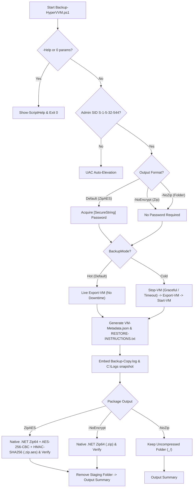
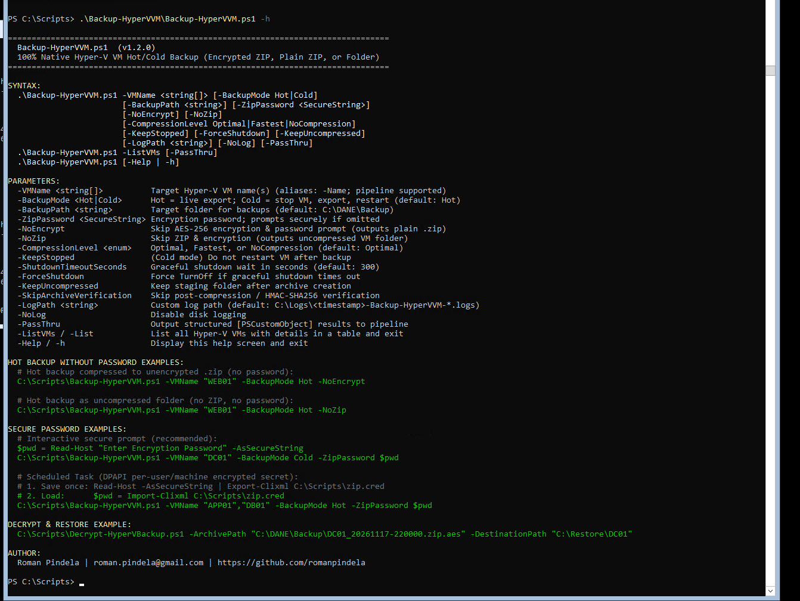
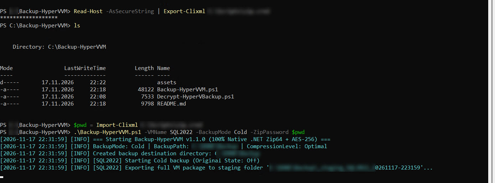

# Backup-HyperVVM

[](https://microsoft.com/powershell)
[](https://www.microsoft.com/windows-server)
[](https://github.com/romanpindela/Windows-Server)
[](https://opensource.org/licenses/MIT)

---

## Overview

`Backup-HyperVVM.ps1` is a **100% native Microsoft** PowerShell/.NET automation script designed for **Windows Server Hyper-V hosts** (including Hyper-V Server Core without GUI; recommended deployment path: `C:\Scripts\Backup-HyperVVM.ps1`). With **zero third-party dependencies**, it creates complete, self-contained backups of one or more Hyper-V virtual machines in `C:\DANE\Backup` in **Hot** (live, zero-downtime, default) or **Cold** mode, complete with VM configuration, virtual hard disks, checkpoints, hardware/vSwitch metadata, step-by-step restore instructions, and copy execution logs.

Three output formats are supported:
- **Encrypted ZIP (`ZipAES`, default):** Native .NET Zip64 compressed and encrypted with **AES-256-CBC + HMAC-SHA256** (`.zip.aes`).
- **Unencrypted ZIP (`-NoEncrypt`):** Native .NET Zip64 archive (`.zip`) with **no password** required.
- **Uncompressed Folder (`-NoZip`):** Direct Hyper-V export folder (`<VMName>_<timestamp>\`) with **no ZIP compression and no password**.

When encryption is enabled, the companion script [`Decrypt-HyperVBackup.ps1`](Decrypt-HyperVBackup.ps1) is automatically copied to `C:\DANE\Backup\` to verify HMAC-SHA256 integrity, decrypt, and extract any `.zip.aes` archive using only built-in .NET APIs.

---

## Technical Architecture



### Output Structure

Depending on the selected options, each backed-up VM produces one of:
- `<VMName>_<yyyyMMdd-HHmmss>.zip.aes` *(Default — encrypted & zipped)*
- `<VMName>_<yyyyMMdd-HHmmss>.zip` *(`-NoEncrypt` — zipped without password)*
- `<VMName>_<yyyyMMdd-HHmmss>\` *(`-NoZip` — uncompressed folder without password)*

```text
<VMName>_<yyyyMMdd-HHmmss>[.zip.aes | .zip | /]
├── <VMName>/
│   ├── Virtual Machines/          # .vmcx, .vmrs, .vmgs configuration files
│   ├── Virtual Hard Disks/        # .vhdx, .vhd, .avhdx disk images
│   └── Snapshots/                 # Checkpoints (if present)
├── VM-Metadata.json               # Hardware, CPU, RAM, disk, and vSwitch mapping
├── RESTORE-INSTRUCTIONS.txt       # Tailored PowerShell & Hyper-V Manager restore guide
├── Backup-Copy.log                # Per-VM copy operation log
└── <timestamp>-Backup-HyperVVM-*.logs  # Full host execution audit log
```

---

## Environment & Prerequisites

- **Operating System:** Windows Server 2016 / 2019 / 2022 / 2025 (Full or Server Core), Microsoft Hyper-V Server, or Windows 10 / 11 Pro (English and Polish editions supported).
- **PowerShell:** Windows PowerShell 5.1 or PowerShell 7+.
- **Built-in Microsoft Components Only (Zero Third-Party Tools):**
  - `Hyper-V` PowerShell module (`Get-VM`, `Stop-VM`, `Start-VM`, `Export-VM`)
  - `.NET` `System.IO.Compression.ZipFile` (Zip64 support for VHDX files > 2 GB)
  - `.NET` `System.Security.Cryptography` (`Rfc2898DeriveBytes` PBKDF2 100,000 iterations, `Aes` 256-bit CBC, `HMACSHA256`)
- **Recommended Deployment Path:** `C:\Scripts\Backup-HyperVVM.ps1` (and `C:\Scripts\Decrypt-HyperVBackup.ps1`)
- **Default Backup Destination:** `C:\DANE\Backup`
- **Default Audit Log Path:** `C:\Logs\<yyyyMMdd-HHmmss>-Backup-HyperVVM-<ComputerName>-<UserName>.logs`

### Unblock & Deploy

```powershell
# Deploy to C:\Scripts on the Hyper-V server
New-Item -Path "C:\Scripts" -ItemType Directory -Force | Out-Null
Copy-Item -Path ".\Backup-HyperVVM.ps1", ".\Decrypt-HyperVBackup.ps1" -Destination "C:\Scripts\" -Force
Unblock-File -Path "C:\Scripts\Backup-HyperVVM.ps1"
Unblock-File -Path "C:\Scripts\Decrypt-HyperVBackup.ps1"
```

---

## Permissions Required

- **Level:** **Admin** (Local Administrator privileges).
- **Verification:** Language-independent check against the Built-in Administrators SID (`S-1-5-32-544`).
- **Note on UAC & `-ZipPassword`:** Running without parameters or with `-Help` / `-h` exits safely without elevation. If passing `-ZipPassword` as a `[SecureString]`, launch PowerShell **As Administrator** first, as `[SecureString]` objects cannot be forwarded across a UAC relaunch. When using `-NoEncrypt` or `-NoZip`, UAC auto-elevation works automatically without launching elevated first.

---

## Safety & Impact

- **Hot Mode (`-BackupMode Hot`, default):** Performs a live `Export-VM` with zero VM downtime.
- **Cold Mode (`-BackupMode Cold`):** Gracefully shuts down running VMs before `Export-VM` and automatically restarts them in a `finally {}` block even if an error occurs (unless `-KeepStopped` is specified).
- **Flexible Password & Compression Options:** Use the default AES-256 encrypted `.zip.aes` archive, `-NoEncrypt` for an unencrypted `.zip` archive (no password), or `-NoZip` for a direct uncompressed VM export folder (no ZIP, no password).
- **Simulation (`-WhatIf` / `-Confirm`):** Declares `SupportsShouldProcess = $true` so all state-changing actions can be previewed safely with `-WhatIf`.
- **Credential & Crypto Hygiene:** When encryption is enabled, passwords are accepted only as `[SecureString]`, never written to logs or console, and cleared from memory (`ZeroFreeBSTR` + `Array::Clear`) in `finally {}`. Encrypted archives use Encrypt-then-MAC (`AES-256-CBC` + `HMAC-SHA256`) with streaming 1 MB buffers for low RAM usage even on multi-gigabyte VHDX backups.

---

## Parameters

| Parameter | Type | Default | Description |
| :--- | :--- | :--- | :--- |
| `-VMName` (`-Name`) | `string[]` | *(Required for backup)* | One or more Hyper-V VM names (pipeline supported). |
| `-BackupMode` (`-Mode`) | `string` | `Hot` | `Hot` (live export) or `Cold` (stop, export, restart). |
| `-BackupPath` | `string` | `C:\DANE\Backup` | Destination directory for `.zip.aes` / `.zip` archives or uncompressed folders. |
| `-ZipPassword` (`-Password`) | `SecureString` | *(Interactive prompt)* | AES-256 encryption password (not used with `-NoEncrypt` / `-NoZip`). |
| `-NoEncrypt` (`-NoPassword`, `-Unencrypted`) | `switch` | `$false` | Skip AES-256 encryption and password prompt; creates a plain `.zip` archive. |
| `-NoZip` (`-SkipZip`, `-NoCompress`, `-Uncompressed`) | `switch` | `$false` | Skip ZIP compression and encryption (no password); saves an uncompressed VM backup folder. |
| `-CompressionLevel` | `string` | `Optimal` | `.NET ZipFile` compression level: `Optimal`, `Fastest`, or `NoCompression`. |
| `-KeepStopped` | `switch` | `$false` | (Cold mode) Do not restart VM after backup. |
| `-ShutdownTimeoutSeconds` | `int` | `300` | Max seconds to wait for graceful shutdown in Cold mode. |
| `-ForceShutdown` | `switch` | `$false` | Force `Stop-VM -TurnOff` if graceful shutdown times out. |
| `-KeepUncompressed` | `switch` | `$false` | Retain staging directory after creating `.zip` or `.zip.aes` archive. |
| `-SkipArchiveVerification` | `switch` | `$false` | Skip post-compression `.zip` or post-encryption `HMAC-SHA256` verification. |
| `-LogPath` (`-l`, `-Log`) | `string` | `C:\Logs\<timestamp>-...logs` | Custom execution log file path. |
| `-NoLog` | `switch` | `$false` | Disable writing execution logs to disk. |
| `-SkipAdminCheck` | `switch` | `$false` | Bypass SID `S-1-5-32-544` elevation check. |
| `-PassThru` | `switch` | `$false` | Return structured `[PSCustomObject]` results to pipeline. |
| `-ListVMs` (`-List`) | `switch` | `$false` | List all Hyper-V VMs on the host with detailed specs in a table and exit. |
| `-Help` (`-h`) | `switch` | `$false` | Display help screen and exit. |

---

## Usage Examples

### 1. Display Help (Zero-Parameter Safe Run)
```powershell
C:\Scripts\Backup-HyperVVM.ps1
```

### 1b. List All Hyper-V Virtual Machines with Details
```powershell
C:\Scripts\Backup-HyperVVM.ps1 -ListVMs
```

### 2. Hot Backup Without Password — Zipped (`.zip`)
Creates a live Hot backup compressed into an unencrypted `.zip` archive without prompting for a password:
```powershell
C:\Scripts\Backup-HyperVVM.ps1 -VMName "WEB01" -BackupMode Hot -NoEncrypt
```

### 3. Hot Backup Without Password — Unzipped (Raw Folder)
Creates a live Hot backup without password and without ZIP compression directly in `C:\DANE\Backup\WEB01_<timestamp>\`:
```powershell
C:\Scripts\Backup-HyperVVM.ps1 -VMName "WEB01" -BackupMode Hot -NoZip
```

### 4. Cold Backup with Secure Interactive Password Prompt
```powershell
$pwd = Read-Host "Enter Encryption Password" -AsSecureString
C:\Scripts\Backup-HyperVVM.ps1 -VMName "DC01" -BackupMode Cold -ZipPassword $pwd
```

### 5. Hot Backup of Multiple VMs (Prompts Securely if `-ZipPassword` Omitted)
```powershell
C:\Scripts\Backup-HyperVVM.ps1 -VMName "APP01", "SQL01" -BackupMode Hot -CompressionLevel Fastest
```

### 6. Unattended Scheduled Task Using Windows DPAPI
Store the encrypted password once under the service account that runs the Scheduled Task:
```powershell
# Run once interactively as the Scheduled Task account:
Read-Host "Enter Backup Password" -AsSecureString | Export-Clixml -Path "C:\Scripts\BackupZip.cred"
```
Then run unattended:
```powershell
$pwd = Import-Clixml -Path "C:\Scripts\BackupZip.cred"
C:\Scripts\Backup-HyperVVM.ps1 -VMName "DC01", "FILE01" -BackupMode Hot -ZipPassword $pwd
```

### 7. Decrypt & Extract an Encrypted Backup Archive
```powershell
C:\Scripts\Decrypt-HyperVBackup.ps1 -ArchivePath "C:\DANE\Backup\DC01_20261117-220000.zip.aes" -DestinationPath "C:\Restore\DC01"
```

---

## Assets

### Standard Run (Zero-Parameter / `-Help`)


### Listing Hyper-V VMs (`-ListVMs`)


### Encrypted VM Backup Execution (`Backup-HyperVVM.ps1`)


---

## Logging & Troubleshooting

- **Host Audit Logs:** `C:\Logs\<yyyyMMdd-HHmmss>-Backup-HyperVVM-<ComputerName>-<UserName>.logs`
- **Embedded Backup Logs:** Every backup package (`.zip.aes`, `.zip`, or uncompressed folder) includes `Backup-Copy.log` and a snapshot of the host execution log.
- **Wrong Password / Corrupted File:** `Decrypt-HyperVBackup.ps1` checks the `HMAC-SHA256` signature before writing any decrypted output and fails immediately if the password is incorrect or the file was modified.

---

## Changelog

- **1.2.0 (2026-11-18):** Added passwordless backup options: `-NoEncrypt` (creates unencrypted `.zip` archive via native .NET Zip64) and `-NoZip` (saves uncompressed VM export folder without ZIP or password); updated `RESTORE-INSTRUCTIONS.txt` per output format, summary table `Format` column, and early empty-password validation.
- **1.1.0 (2026-11-17):** Replaced external `7z.exe` dependency with 100% native Microsoft `.NET ZipFile` (Zip64) + streaming `AES-256-CBC` + `HMAC-SHA256` encryption (`.zip.aes`) and added `Decrypt-HyperVBackup.ps1`.
- **1.0.0 (2026-11-17):** Initial release supporting Hot/Cold Hyper-V VM backups, `Export-VM` full recovery packages, `VM-Metadata.json`, `RESTORE-INSTRUCTIONS.txt`, and embedded copy logs.

---

## Author

- **Author:** Roman Pindela
- **Email:** [roman.pindela@gmail.com](mailto:roman.pindela@gmail.com)
- **GitHub:** [https://github.com/romanpindela](https://github.com/romanpindela)
- **Repository:** [https://github.com/romanpindela/Windows-Server](https://github.com/romanpindela/Windows-Server)
- **License:** MIT
