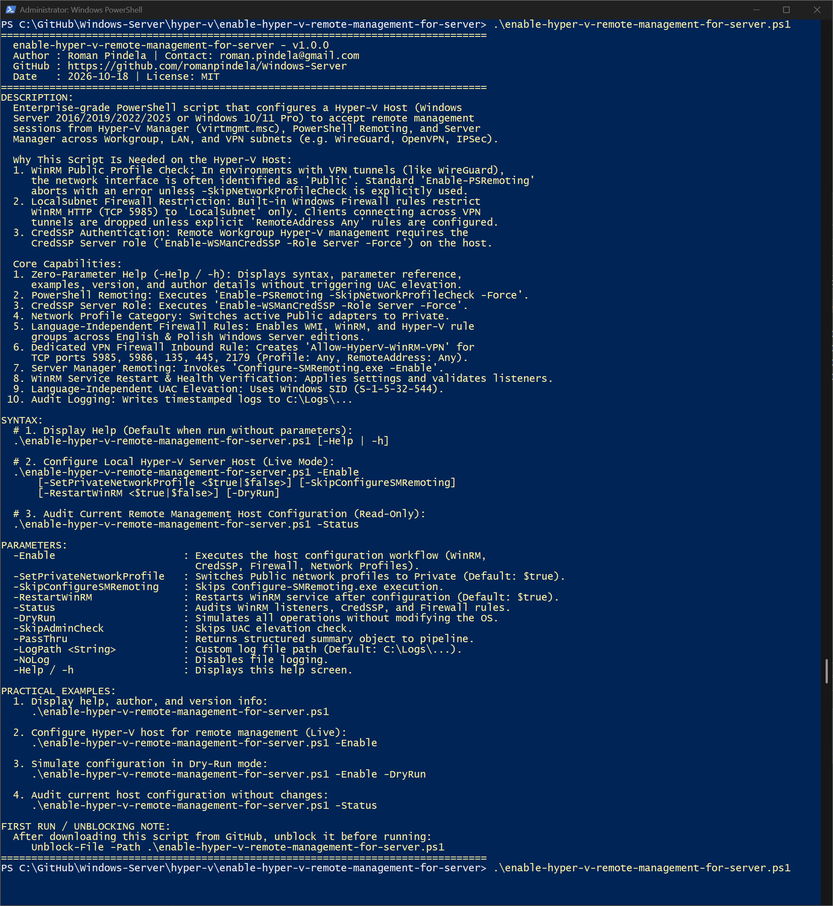
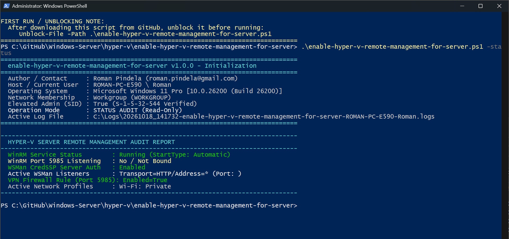

# Enable-HyperVRemoteManagementForServer

[](https://microsoft.com/powershell)
[](https://www.microsoft.com/windows-server)
[](https://github.com/romanpindela/Windows-Server)
[](https://opensource.org/licenses/MIT)

---

## Problem Statement

When managing standalone Hyper-V hosts in a **Workgroup** (without Active Directory / Kerberos) across a **LAN or VPN tunnel (such as WireGuard, OpenVPN, or IPSec)**, default Windows Server configurations block remote management connections due to three major hurdles:

1. **WinRM Public Network Profile Block:** VPN adapters (such as WireGuard interfaces) are frequently classified by Windows as `Public`. Standard `Enable-PSRemoting -Force` aborts immediately with an error stating that the WinRM firewall exception will not work when a network connection type is set to `Public`.
2. **Windows Firewall `LocalSubnet` Restriction:** Default Windows Firewall rules for WinRM (TCP port `5985`) restrict inbound traffic to `LocalSubnet` only. Clients connecting over a VPN tunnel arrive from a different IP subnet and are dropped with connection timeout errors unless explicit `RemoteAddress Any` rules are configured.
3. **CredSSP Server Role Prerequisite:** Remote Workgroup Hyper-V management requires delegating NTLM credentials via CredSSP, which fails unless the CredSSP Server authentication role is explicitly enabled on the host.

---

## Overview

`Enable-HyperVRemoteManagementForServer.ps1` automates the complete host-side configuration required for remote management via **Hyper-V Manager (`virtmgmt.msc`)**, **PowerShell Remoting**, and **Server Manager** across Workgroup, LAN, and VPN environments. It configures WinRM with `-SkipNetworkProfileCheck`, enables the WSMan CredSSP Server role, switches `Public` network profiles to `Private`, provisions language-independent Windows Firewall rules plus a dedicated VPN rule, and offers read-only `-Status` diagnostics and `-DryRun` simulation.

---

## Environment & Prerequisites

- **Operating System:** Windows Server 2016 / 2019 / 2022 / 2025, or Windows 10 / 11 Pro (English and Polish editions supported).
- **PowerShell:** Windows PowerShell 5.1 or PowerShell 7+.
- **Required Modules & System Tools (Built-in):**
  - `Microsoft.PowerShell.Core` / `Microsoft.PowerShell.Management` (`Enable-PSRemoting`, `Get-Service`, `Restart-Service`)
  - `Microsoft.WSMan.Management` (`Enable-WSManCredSSP`, `WSMan:\` provider)
  - `NetConnection` (`Get-NetConnectionProfile`, `Set-NetConnectionProfile`)
  - `NetSecurity` (`Get-NetFirewallRule`, `Enable-NetFirewallRule`, `Set-NetFirewallRule`, `New-NetFirewallRule`, `Remove-NetFirewallRule`)
  - `NetTCPIP` (`Get-NetTCPConnection`)
  - `CimCmdlets` (`Get-CimInstance`)
  - `Configure-SMRemoting.exe` (included on Windows Server; automatically skipped on client/desktop editions)
- **Client Counterpart:** On the managing Windows 10/11 client workstation, run `Enable-HyperVRemoteManagement.ps1` from the `Windows-Desktop` repository.

---

## Permissions Required

- **Level:** **Admin** (Administrator privileges required).
- **Justification:** Modifying WinRM listeners, enabling the WSMan CredSSP Server role, altering network adapter connection categories (`Public` to `Private`), provisioning Windows Firewall rules, enabling Server Manager remoting, and restarting the `WinRM` service all require elevated local Administrator privileges.
- **Behavior:** Running the script without parameters or with `-Help` / `-h` displays help safely without elevation. Running `-Enable` or `-Status` verifies membership in the Built-in Administrators SID (`S-1-5-32-544`) in a language-independent manner and automatically triggers a UAC elevation prompt (unless `-SkipAdminCheck` is passed).

---

## Safety & Impact

- **Risk Level:**
  - **Modifies system state** when executed with `-Enable` (enables PowerShell Remoting and WinRM HTTP listener on TCP 5985, enables WSMan CredSSP Server role, switches `Public` network connection profiles to `Private` unless `-SetPrivateNetworkProfile:$false`, enables built-in WMI/WinRM/Hyper-V firewall rules with `Profile Any` and `RemoteAddress Any`, creates/replaces inbound rule `Allow-HyperV-WinRM-VPN` for TCP ports `5985`, `5986`, `135`, `445`, and `2179`, invokes `Configure-SMRemoting.exe -Enable`, and restarts the `WinRM` service).
  - **Read-Only / Non-destructive** when executed with `-Status` (audit mode) or without parameters / `-Help`.
- **Dry-Run / Simulation Support:**
  - Supports **`-DryRun`** (aliases `-Simulate`, `-Preview`) to preview all configuration steps without modifying the operating system.
  - Declares `SupportsShouldProcess = $true` in `[CmdletBinding()]` (exposing common `-WhatIf` / `-Confirm` parameters), while simulation logic is handled explicitly via `-DryRun`.
- **Backups & Logging:**
  - Does **not** create backups of prior WinRM or Windows Firewall configurations.
  - Writes timestamped UTF-8 audit logs by default to `C:\Logs\<yyyyMMdd_HHmmss>-Enable-HyperVRemoteManagementForServer-<ComputerName>-<UserName>.logs` (customizable via `-LogPath`, or disabled via `-NoLog`).

---

## Usage Examples

### Unblock the Script After Download
When downloading the script from GitHub, unblock it before execution:
```powershell
Unblock-File -Path .\Enable-HyperVRemoteManagementForServer.ps1
```

### 1. Display Help & Syntax (Zero-Parameter Run)
```powershell
.\Enable-HyperVRemoteManagementForServer.ps1
```

### 2. Configure Local Hyper-V Server Host (Live Mode)
```powershell
.\Enable-HyperVRemoteManagementForServer.ps1 -Enable
```

### 3. Audit Current Remote Management Host Configuration (Read-Only)
```powershell
.\Enable-HyperVRemoteManagementForServer.ps1 -Status
```

### 4. Simulate Host Configuration in Dry-Run Mode
```powershell
.\Enable-HyperVRemoteManagementForServer.ps1 -Enable -DryRun
```

### 5. Configure Host Without Changing Network Profiles or Restarting WinRM
```powershell
.\Enable-HyperVRemoteManagementForServer.ps1 -Enable -SetPrivateNetworkProfile:$false -RestartWinRM:$false
```

### 6. Run with Custom Log Path and Pipeline Output
```powershell
.\Enable-HyperVRemoteManagementForServer.ps1 -Enable -LogPath "C:\Logs\hyperv-host.log" -PassThru
```

---

## Key Features

- **Zero-Parameter Interactive Help (`-Help` / `-h`):** Displays syntax, parameter reference, examples, version (`1.0.0`), and author details without triggering UAC elevation.
- **Skip Network Profile Check (`-SkipNetworkProfileCheck`):** Enables WinRM even when virtual or VPN network adapters are marked as `Public`.
- **Network Profile Hardening (`-SetPrivateNetworkProfile`):** Automatically switches active `Public` network profiles to `Private`.
- **Dedicated Multi-Port VPN Firewall Rule:** Creates `Allow-HyperV-WinRM-VPN` allowing TCP `5985` (WinRM HTTP), `5986` (WinRM HTTPS), `135` (RPC/DCOM), `445` (SMB), and `2179` (Hyper-V VMConnect) across all profiles and remote addresses.
- **Language-Independent Firewall Rule Groups:** Enables WMI, WinRM, and Hyper-V rule groups across both English and Polish Windows Server editions.
- **Server Manager Remoting:** Runs `Configure-SMRemoting.exe -Enable` on Windows Server editions.
- **Language-Independent UAC Auto-Elevation:** Checks Administrator privileges via Windows SID `S-1-5-32-544`.

---

## Client-Server Architecture Workflow

```text
+-------------------------------------------------------------+
| CLIENT WORKSTATION (Windows 10/11)                          |
| Script: Enable-HyperVRemoteManagement.ps1                   |
| - Hosts file: '10.10.1.10  SERWER'                          |
| - WinRM TrustedHosts: 'SERWER, 10.10.1.10'                  |
| - CredSSP Client: wsman/SERWER                              |
| - GPO Delegation: AllowFreshCredentialsWhenNTLMOnly         |
+-------------------------------------------------------------+
                              │
                              │ [WireGuard VPN Tunnel: TCP 5985, 135, 2179]
                              ▼
+-------------------------------------------------------------+
| HYPER-V HOST SERVER (Windows Server / SERWER)               |
| Script: Enable-HyperVRemoteManagementForServer.ps1          |
| - WinRM HTTP Listener: Port 5985 (SkipNetworkProfileCheck)  |
| - CredSSP Server Role: Enabled                              |
| - Firewall Rule: Allow-HyperV-WinRM-VPN (Any RemoteAddress) |
| - Network Profile: Private                                  |
| - Configure-SMRemoting: Enabled                             |
+-------------------------------------------------------------+
```

---

## Screenshots

### 1. Live Configuration (`-Enable`)
Executing the complete automated configuration on the Hyper-V host (WinRM listener, CredSSP server role, network profile hardening, dedicated VPN firewall rules, and WinRM service restart):



### 2. Diagnostic & Audit Mode (`-Status`)
Read-only inspection of the active Hyper-V host state (WinRM service, Port 5985 listener status, CredSSP server authentication, and VPN firewall rule):



---

## Author

- **Author:** Roman Pindela
- **Email:** [roman.pindela@gmail.com](mailto:roman.pindela@gmail.com)
- **GitHub:** [https://github.com/romanpindela](https://github.com/romanpindela)
- **Repository:** [https://github.com/romanpindela/Windows-Server](https://github.com/romanpindela/Windows-Server)
- **Version:** 1.0.0 (2026-10-18)
- **License:** MIT
