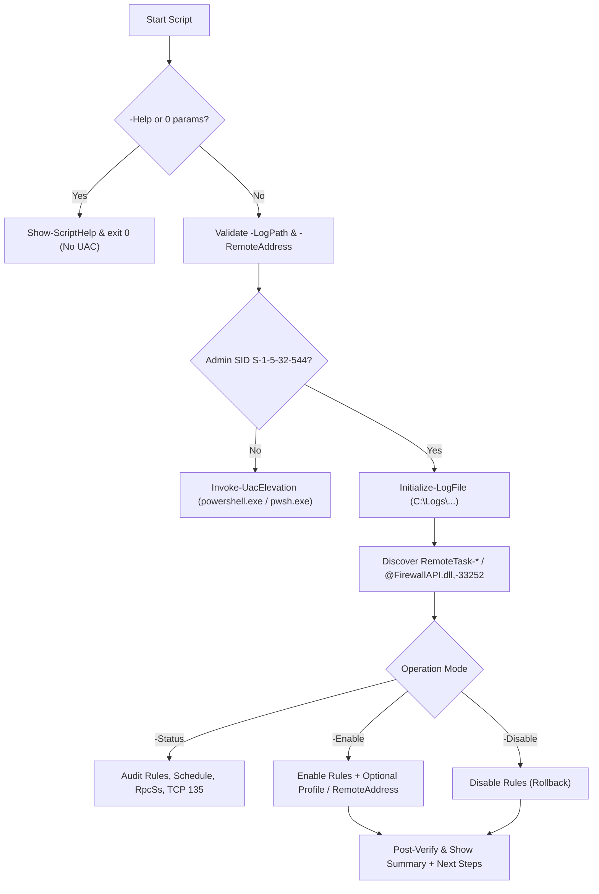

# Enable-RemoteTaskSchedulerFirewall

[](https://microsoft.com/powershell)
[](https://www.microsoft.com/windows-server)
[](https://github.com/romanpindela/Windows-Server)
[](https://opensource.org/licenses/MIT)

---

## Overview

`Enable-RemoteTaskSchedulerFirewall.ps1` automates enabling, auditing, and disabling the **Windows Defender Firewall** rules required for remote **Task Scheduler (`taskschd.msc` / RSAT)** management via Microsoft Management Console (MMC) on a **Hyper-V Server** or **Windows Server** host.

### Problem Solved

When connecting remotely from an administrator workstation (such as Windows 11 `RPINDELA-PC`) via `taskschd.msc` → **Connect to Another Computer...**, Windows Server blocks inbound Task Scheduler RPC traffic by default with timeouts or `RPC server is unavailable` errors. Furthermore:

1. **Localized Firewall Group Names:** GUI and PowerShell `DisplayGroup` strings differ between English (`Remote Scheduled Tasks Management`) and Polish (`Zdalne zarządzanie zaplanowanymi zadaniami`) Windows installations. This script targets language-independent rule names (`RemoteTask-*`) and Windows Firewall API resource identifiers (`@FirewallAPI.dll,-33252`).
2. **`LocalSubnet` Restriction Across VPN/VLANs:** Windows defaults the `Private` and `Public` `RemoteTask-*` rules to `RemoteAddress = LocalSubnet`. Administrators connecting over WireGuard, OpenVPN, or a management VLAN need optional `-RemoteAddress` and `-FirewallProfile` overrides.

---

## Technical Architecture

### Execution Flow (Mermaid)



### Client–Server Firewall Flow (ASCII)

```text
+-------------------------------------------------------------------+
| ADMIN WORKSTATION (Windows 10 / 11 - e.g. RPINDELA-PC)            |
| MMC Console: taskschd.msc -> "Connect to Another Computer..."     |
+-------------------------------------------------------------------+
                                  |
                                  | 1. TCP 135 (RPC Endpoint Mapper: RPCEPMap)
                                  | 2. TCP Dynamic Ephemeral Ports (RPC -> Schedule)
                                  v
+-------------------------------------------------------------------+
| HYPER-V SERVER HOST (Windows Server 2016-2025 / EN or PL)         |
| Script: Enable-RemoteTaskSchedulerFirewall.ps1                    |
|                                                                   |
| Firewall Group: @FirewallAPI.dll,-33252                           |
| - RemoteTask-RPCSS-In-TCP         (TCP 135 | Private, Public)     |
| - RemoteTask-RPCSS-In-TCP-NoScope (TCP 135 | Domain)              |
| - RemoteTask-In-TCP               (RPC     | Private, Public)     |
| - RemoteTask-In-TCP-NoScope       (RPC     | Domain)              |
|                                                                   |
| Services Verified: Schedule (Task Scheduler), RpcSs (RPC)         |
+-------------------------------------------------------------------+
```

---

## Prerequisites

- **Target Host OS:** Windows Server 2016 / 2019 / 2022 / 2025 (Core or Desktop Experience) or Windows 10/11 Pro/Enterprise (English & Polish).
- **PowerShell:** Windows PowerShell `5.1` or PowerShell `7+`.
- **Built-In Modules:** `NetSecurity`, `NetTCPIP`, `NetConnection`, `CimCmdlets`, `Microsoft.PowerShell.Management`.
- **First-Run Script Unblocking:**
  ```powershell
  Unblock-File -Path ".\Enable-RemoteTaskSchedulerFirewall.ps1"
  ```

---

## Permissions Required & Safety

- **Permissions:** **Admin** (Administrator privileges verified language-independently via SID `S-1-5-32-544`).
- **Zero-Parameter Safety:** Running without parameters or with `-Help` / `-h` prints documentation safely without UAC elevation.
- **Simulation:** Supports both standard PowerShell **`-WhatIf` / `-Confirm`** (`SupportsShouldProcess`) and **`-DryRun`**.
- **Rollback:** Run with **`-Disable`** at any time to turn off all `RemoteTask-*` inbound rules.

---

## Parameters

| Parameter | Type | Default | Description |
| :--- | :--- | :--- | :--- |
| `-Enable` | `[switch]` | `$false` | Enables `RemoteTask-*` firewall rules. Aliases: `-Configure`, `-Apply`. |
| `-Disable` | `[switch]` | `$false` | Disables `RemoteTask-*` firewall rules. Aliases: `-Block`, `-Revert`. |
| `-Status` | `[switch]` | `$false` | Read-only audit of firewall rules, `Schedule`/`RpcSs` services, and TCP 135. Aliases: `-Check`, `-Verify`, `-Info`. |
| `-FirewallProfile` | `[string[]]` | `@('Preserve')` | Sets firewall profile (`Preserve`, `Domain`, `Private`, `Public`, `Any`). |
| `-RemoteAddress` | `[string[]]` | *(Preserve)* | Optional IP, CIDR subnet (e.g. `10.10.1.0/24`), `LocalSubnet`, or `Any`. |
| `-DryRun` | `[switch]` | `$false` | Simulates changes without modifying the firewall. Aliases: `-Simulate`, `-Preview`. |
| `-WhatIf` | `[switch]` | `$false` | Standard PowerShell `ShouldProcess` preview mode. |
| `-SkipAdminCheck` | `[switch]` | `$false` | Skips automatic UAC elevation check. |
| `-PassThru` | `[switch]` | `$false` | Returns a structured `[PSCustomObject]` summary object. |
| `-LogPath` | `[string]` | `C:\Logs\...` | Custom UTF-8 log file path. Aliases: `-l`, `-Log`. |
| `-NoLog` | `[switch]` | `$false` | Disables writing logs to disk. |
| `-Help` / `-h` | `[switch]` | `$false` | Displays help and exits cleanly. |

---

## Usage Examples

### 1. Display Help (Zero-Parameter Safe Run)
```powershell
.\Enable-RemoteTaskSchedulerFirewall.ps1
```

### 2. Audit Current Firewall & Service Status (Read-Only)
```powershell
.\Enable-RemoteTaskSchedulerFirewall.ps1 -Status
```

### 3. Enable Firewall Rules (Built-In Windows Scope)
```powershell
.\Enable-RemoteTaskSchedulerFirewall.ps1 -Enable
```

### 4. Enable Firewall Rules for VPN / Cross-Subnet Management
```powershell
.\Enable-RemoteTaskSchedulerFirewall.ps1 -Enable -FirewallProfile Private,Domain -RemoteAddress Any
```

### 5. Preview Changes with `-WhatIf` or `-DryRun`
```powershell
.\Enable-RemoteTaskSchedulerFirewall.ps1 -Enable -RemoteAddress "10.10.1.0/24" -WhatIf
```

### 6. Disable Firewall Rules (Rollback)
```powershell
.\Enable-RemoteTaskSchedulerFirewall.ps1 -Disable
```

---

## Assets

Supporting screenshots and diagrams can be stored in the [`assets/`](assets/) directory.

---

## Logging & Troubleshooting

- **Log Location:** `C:\Logs\<yyyyMMdd-HHmmss>-Enable-RemoteTaskSchedulerFirewall-<ComputerName>-<UserName>.logs` (UTF-8).
- **Workgroup Authentication Note:** If the Hyper-V host is in a **Workgroup** (not joined to Active Directory) and `taskschd.msc` prompts for access or returns *Access Denied*, cache host administrator credentials on the admin workstation before opening `taskschd.msc`:
  ```cmd
  cmdkey /add:<HyperV-Host-Or-IP> /user:<HyperV-Host>\Administrator /pass:*
  ```
- **VPN / Routed Subnets:** If `taskschd.msc` times out over WireGuard/OpenVPN, verify the VPN interface is `Private` (or pass `-FirewallProfile Any`) and pass `-RemoteAddress Any` or your VPN CIDR subnet.

---

## Changelog

### `1.0.0` — 2026-11-18
- Initial release with language-independent `RemoteTask-*` / `@FirewallAPI.dll,-33252` discovery, `-Enable`, `-Disable`, `-Status`, `-FirewallProfile`, `-RemoteAddress`, `-WhatIf`, `-DryRun`, `Write-Progress`, SID-based UAC elevation (`S-1-5-32-544`), PS 5.1/7+ dual compatibility, and `C:\Logs\` logging.

---

## Author

- **Author:** Roman Pindela
- **Email:** [roman.pindela@gmail.com](mailto:roman.pindela@gmail.com)
- **GitHub:** [https://github.com/romanpindela](https://github.com/romanpindela)
- **Repository:** [https://github.com/romanpindela/Windows-Server](https://github.com/romanpindela/Windows-Server)
- **License:** MIT
