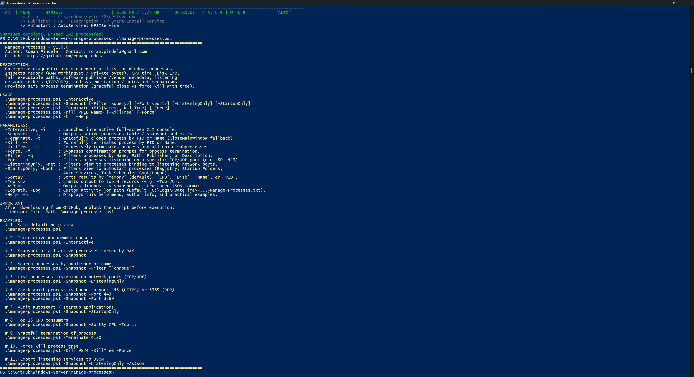
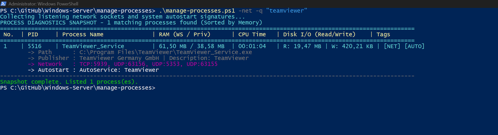
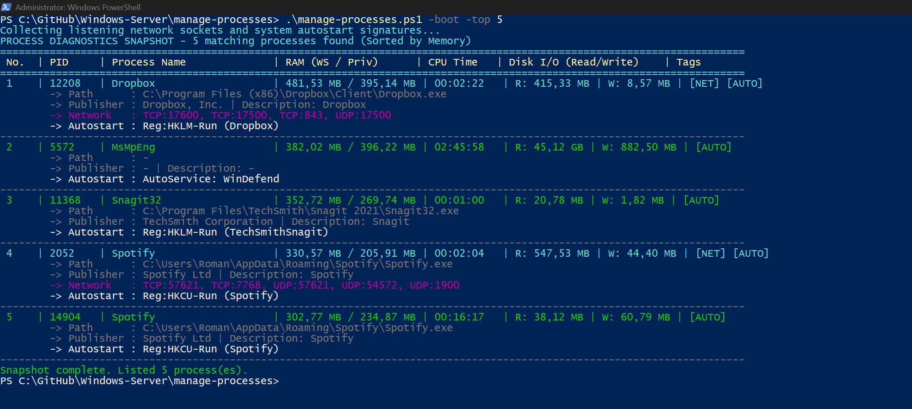

# Manage-Processes

[](https://microsoft.com/powershell)
[](https://www.microsoft.com/windows)
[](https://github.com/romanpindela/Windows-Server)
[](mailto:roman.pindela@gmail.com)
[](https://opensource.org/licenses/MIT)

---

## Problem Statement

Diagnosing unresponsive servers, port conflicts (such as IIS, Apache, Nginx, Tomcat, SQL Server, or MySQL failing to bind to a port), and unauthorized background persistence typically requires jumping across Task Manager, Resource Monitor, `netstat`, `sc.exe`, Registry Editor, and Task Scheduler. Standard tools do not correlate a running PID with its hosted Windows Services, listening TCP/UDP sockets, autostart origin, Disk I/O, and full command line in one actionable view with safe termination guardrails.

---

## Overview

`Manage-Processes.ps1` is an enterprise process management, performance diagnostics, autostart persistence, and network socket correlation utility for Windows Desktop and Windows Server environments. It provides both an interactive management console (`-Interactive`) and non-interactive CLI modes (`-Snapshot`, `-Port`, `-ListeningOnly`, `-Terminate`, `-Kill`) with JSON export and critical kernel process protection.

---

## Environment & Prerequisites

- **Operating System:** Windows 10, Windows 11, or Windows Server 2016 / 2019 / 2022 / 2025 (x64 / ARM64).
- **PowerShell:** Windows PowerShell 5.1 or PowerShell 7+.
- **Required Modules & System Components (Built-in):**
  - `Microsoft.PowerShell.Management` (`Get-Process`, `Stop-Process`)
  - `NetTCPIP` (`Get-NetTCPConnection`, `Get-NetUDPEndpoint`)
  - `CimCmdlets` (`Get-CimInstance` for `Win32_Process` and `Win32_Service`)
  - `ScheduledTasks` (`Get-ScheduledTask` for Boot/Logon autostart correlation)
  - `WScript.Shell` COM object (for resolving `.lnk` shortcuts in Windows Startup folders)
  - `taskkill.exe` (native Windows utility used when `-KillTree` is specified)

---

## Permissions Required

- **Level:** **Admin** (Administrator privileges required for full inspection and system-wide termination; falls back gracefully to current user privileges if UAC is cancelled).
- **Justification:** Inspecting executable paths, command-line arguments, hosted Windows Services, and listening sockets of elevated or system processes—as well as terminating services/processes owned by other accounts or `SYSTEM`—requires Administrator privileges.
- **Behavior:** Running without parameters or with `-Help` / `-h` displays help safely without elevation. All operational modes invoke `Assert-AdministratorElevation` using language-independent Well-Known SID `S-1-5-32-544` (`BuiltInAdministratorsSid`) and prompt for UAC elevation, continuing in limited read mode if elevation is unavailable or cancelled.

---

## Safety & Impact

- **Risk Level:**
  - **Read-Only / Non-destructive** when running without parameters / `-Help`, `-Snapshot`, `-ListeningOnly`, or `-Port <port>` (without `-KillPort`, `-Kill`, or `-Terminate`).
  - **Modifies system state** when running `-Terminate`, `-Kill`, `-KillPort`, or issuing termination commands (`t`, `k`, `kt`) inside `-Interactive` mode (stops processes or entire process trees via `taskkill.exe /F /T`).
- **WhatIf / Confirm / DryRun Support:**
  - Does **not** support `-WhatIf`, `-Confirm`, or `-DryRun`.
  - Uses confirmation prompts for multi-process matches and critical system processes (`'YES-FORCE'` required for protected system binaries like `svchost`, `lsass`, `csrss`, unless `-Force` is supplied), while PIDs `0` and `4` (`system`, `idle`) are strictly blocked from termination.
- **Backups & Logging:**
  - Does **not** create backups before terminating processes.
  - Writes timestamped UTF-8 activity logs by default to `C:\Logs\<yyyyMMdd_HHmmss>-<ComputerName>-<UserName>-Manage-Processes.txt` (customizable via `-LogPath`).

---

## Usage Examples

### 1. Unblock and View Built-in Help
```powershell
Unblock-File -Path .\Manage-Processes.ps1
.\Manage-Processes.ps1
.\Manage-Processes.ps1 -Help
```

### 2. Interactive Management Console
```powershell
.\Manage-Processes.ps1 -Interactive
```
Inside the interactive console:
- `s <query>` : Filter processes by name, executable path, or publisher (e.g., `s chrome`, `s python`, `s *` to reset).
- `p <port>` : Inspect listening port (e.g., `p 80`, `p 443`, `p 0` to reset).
- `net` : Toggle Network-only filter (processes listening on TCP/UDP sockets).
- `boot` : Toggle Autostart-only filter (boot/logon/service startup programs).
- `sort <metric>` : Switch sort metric (`sort mem`, `sort cpu`, `sort disk`, `sort name`, `sort pid`).
- `i <nr|pid>` : Open detailed Process Inspection Card.
- `t <nr|pid>` : Gracefully terminate process by table row number or PID.
- `k <nr|pid>` : Force kill process by table row number or PID.
- `kt <nr|pid>` : Force kill process and its entire child process tree.
- `r` / `c` / `q` : Refresh live metrics / Re-cache autostart signatures / Quit.

### 3. Port Blocker Diagnostics & Socket Release
```powershell
# Check if port 8080 is free, or identify the blocking process/service
.\Manage-Processes.ps1 -Port 8080

# Identify web server or database holding port 443 / 1433 / 3306
.\Manage-Processes.ps1 -Port 443
.\Manage-Processes.ps1 -Port 1433

# Gracefully terminate or force kill the process holding port 8080
.\Manage-Processes.ps1 -Port 8080 -Terminate
.\Manage-Processes.ps1 -Port 8080 -KillPort -Force
.\Manage-Processes.ps1 -Port 8080 -KillPort -KillTree -Force

# Overview of all listening TCP & UDP sockets
.\Manage-Processes.ps1 -ListeningOnly
.\Manage-Processes.ps1 -ListeningOnly -Filter "sql" -Top 15

# Export port diagnostics or listening sockets to JSON
.\Manage-Processes.ps1 -Port 8080 -AsJson
.\Manage-Processes.ps1 -ListeningOnly -AsJson | Out-File -FilePath "C:\Logs\listening_sockets.json" -Encoding UTF8
```

### 4. Non-Interactive Process Snapshots
```powershell
# Snapshot sorted by Memory (default)
.\Manage-Processes.ps1 -Snapshot

# Filter by Name, Path, or Publisher
.\Manage-Processes.ps1 -Snapshot -Filter "*Python*"

# Inspect autostart & persistence processes
.\Manage-Processes.ps1 -Snapshot -StartupOnly

# Top 10 CPU or Disk I/O consumers
.\Manage-Processes.ps1 -Snapshot -SortBy CPU -Top 10
.\Manage-Processes.ps1 -Snapshot -SortBy Disk -Top 10

# Export snapshot to JSON
.\Manage-Processes.ps1 -Snapshot -StartupOnly -AsJson
```

### 5. Process Termination
```powershell
# Graceful termination by PID or name
.\Manage-Processes.ps1 -Terminate 5412
.\Manage-Processes.ps1 -Terminate "notepad" -Force

# Force kill by PID or name
.\Manage-Processes.ps1 -Kill 8920 -Force
.\Manage-Processes.ps1 -Kill "chrome" -Force

# Force kill process tree (parent + child subprocesses)
.\Manage-Processes.ps1 -Kill 10420 -KillTree -Force
```

---

## Key Features

- **Advanced Network Sockets & Port Blocker Diagnostics:** Identifies processes or hosted Windows Services (`W3SVC`, `WinRM`, `MSSQLSERVER`, etc.) holding TCP/UDP ports, reports free ports immediately (`[OK] Port <Port> jest wolny`), and supports one-command release (`-KillPort`).
- **Comprehensive Multi-Line Process Diagnostics:** Displays PID, RAM (Working Set / Private Bytes), CPU Time, Disk I/O (Read/Write), executable path, publisher/description, listening sockets, and autostart persistence origin.
- **Autostart & Persistence Detection:** Correlates processes against Registry `Run`/`RunOnce` (`HKLM`, `HKCU`, `WOW6432Node`), Windows Startup folders, `Auto`-start Windows Services, and Boot/Logon Scheduled Tasks.
- **Process Lifecycle Management & Safety Guards:** Supports graceful close (`CloseMainWindow`), forceful kill (`Stop-Process -Force`), and recursive tree kill (`taskkill.exe /F /T /PID`) with core OS process shielding.
- **Input Sanitization:** Validates string parameters (`-Filter`, `-Terminate`, `-Kill`) against dangerous injection characters (`;`, `|`, `"`, `$`, `&`, newlines).

---

## Screenshots

### Standard Run & Interactive Management Console
Comprehensive multi-line diagnostic display with real-time memory (Working Set / Private bytes), CPU time, disk I/O, binary paths, vendor metadata, listening sockets, and autostart tags:



### Filtering Network Listening Processes (`-ListeningOnly` / `[net]`)
Filtered view isolating active network daemons and sockets with bound TCP/UDP ports and service mapping:



### Autostart & Boot Persistence Audit (`-StartupOnly` / `[boot]`)
Identifies background processes launched via Registry Run, Windows Startup Folders, Automatic Services, and Scheduled Tasks:



---

## Parameters Reference

| Parameter | Alias | Type | Description |
|:---|:---:|:---:|:---|
| `-Interactive` | `-i` | Switch | Launches the interactive full-screen CLI control console. |
| `-Port` | `-p`, `-CheckPort`, `-FindPort` | Int | Diagnoses target network port (`TCP`/`UDP`), locating blocking processes or services. |
| `-Protocol` | — | String | Specifies protocol to inspect with `-Port`: `TCP`, `UDP`, or `All` (default). |
| `-KillPort` | `-kp`, `-KillListener` | Switch | Forcefully terminates or kills the process currently holding the target `-Port`. |
| `-ListeningOnly` | `-net`, `-Listening`, `-Sockets`, `-ListeningPorts` | Switch | Displays dedicated overview of all listening network ports and sockets. |
| `-Snapshot` | `-s`, `-l`, `-List`, `-ListOnly` | Switch | Outputs process diagnostics table to stdout and exits. |
| `-Terminate` | `-t`, `-Stop` | String | Gracefully terminates process by PID or Name pattern. |
| `-Kill` | `-k`, `-ForceKill` | String | Forcefully terminates process by PID or Name pattern. |
| `-KillTree` | `-tree`, `-kt` | Switch | Kills process and all spawned child subprocesses recursively. |
| `-Force` | `-f`, `-Quiet` | Switch | Suppresses interactive confirmation prompts. |
| `-Filter` | `-q`, `-Pattern`, `-Name` | String | Wildcard query filtering Name, Path, Publisher, Description, or CommandLine. |
| `-StartupOnly` | `-boot`, `-Startup` | Switch | Displays only processes identified as autostart items. |
| `-SortBy` | — | String | Sorts by `Memory` (default), `CPU`, `Disk`, `Name`, `PID`, or `Port`. |
| `-Top` | — | Int | Limits output to the top N processes matching criteria. |
| `-AsJson` | — | Switch | Formats output in structured JSON for automation and SIEM ingestion. |
| `-LogPath` | `-Log` | String | Custom log file path (Default: `C:\Logs\<Timestamp>-...-Manage-Processes.txt`). |
| `-Help` | `-h` | Switch | Displays help guide, author information, and examples. |

---

## Version History

### [1.1.0] - 2026-10-13
- **Port Blocker Diagnostics:** Added instant discovery of processes and Windows Services holding or blocking designated TCP/UDP network ports (`-Port <port>`).
- **Free Port Verification:** Reports free port availability immediately with green console status.
- **Hosted Windows Service Correlation:** Inspects and lists Windows Services hosted within the blocking process.
- **One-Command Port Release:** Added `-KillPort` (`-kp`) switch to immediately terminate or kill the blocking process holding the port.
- **Dedicated Listening Sockets View:** Added `-ListeningOnly` dedicated view listing all listening sockets with PIDs, services, versions, and paths.

### [1.0.0] - 2026-10-13
- **Initial Release:** Comprehensive process manager with multi-line diagnostic display, interactive console mode, resource tracking (RAM, CPU, Disk I/O), autostart detection, process termination guardrails, and language-independent SID UAC elevation.

---

## Author

- **Author:** Roman Pindela
- **Email:** [roman.pindela@gmail.com](mailto:roman.pindela@gmail.com)
- **GitHub:** [https://github.com/romanpindela](https://github.com/romanpindela)
- **Repository:** [https://github.com/romanpindela/Windows-Server](https://github.com/romanpindela/Windows-Server)
- **Version:** 1.1.0 (2026-10-13)
- **License:** MIT
