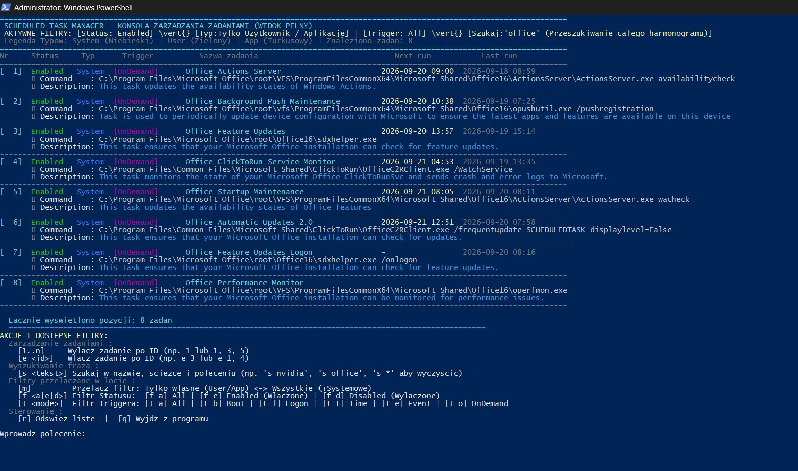
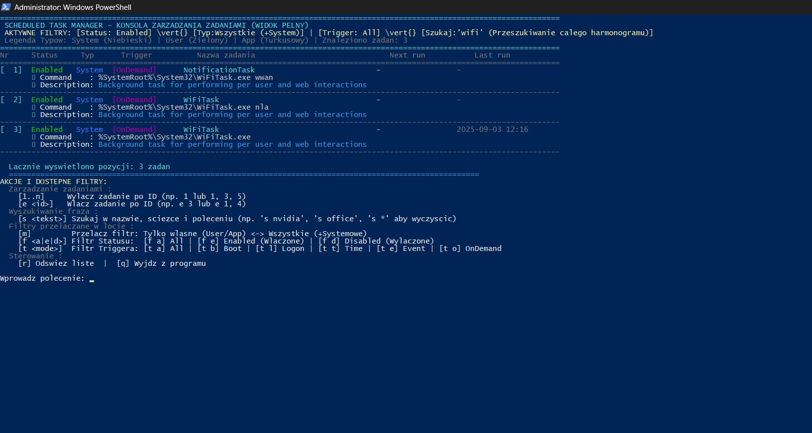
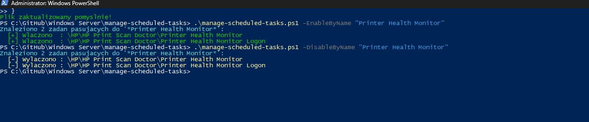

# Manage-ScheduledTasks

[](https://microsoft.com/powershell)
[](https://www.microsoft.com/windows)
[](https://github.com/romanpindela/Windows-Server)
[](mailto:roman.pindela@gmail.com)
[](https://opensource.org/licenses/MIT)

---

## Problem Statement

The native Windows Task Scheduler GUI (`taskschd.msc`) organizes tasks into deeply nested folders, making it slow to get a chronological overview of upcoming tasks, search across task names and executable commands, or batch-enable/disable third-party update and telemetry tasks across folders. Administrators need a fast terminal workflow to audit triggers, commands, and descriptions in one flat view and toggle tasks reliably by ID or wildcard name.

---

## Overview

`Manage-ScheduledTasks.ps1` is an interactive and CLI-driven management utility for Windows Scheduled Tasks across Windows Desktop and Windows Server environments. It renders a structured multi-line table categorized by task origin (`System`, `User`, `App`) sorted chronologically by next run time, and supports real-time substring search, trigger/state filtering, and batch enabling or disabling by ID or wildcard name.

---

## Environment & Prerequisites

- **Operating System:** Windows 10, Windows 11, or Windows Server 2016 / 2019 / 2022 / 2025.
- **PowerShell:** Windows PowerShell 5.1 or PowerShell 7+.
- **Required Modules (Built-in):**
  - `ScheduledTasks` (`Get-ScheduledTask`, `Get-ScheduledTaskInfo`, `Enable-ScheduledTask`, `Disable-ScheduledTask`).
- **Terminal Recommendation:** A console host supporting ANSI VT100 escape sequences (Windows Terminal, PowerShell 7 console, or modern Windows 10/11 conhost) for colorized output.

---

## Permissions Required

- **Level:** **Admin** (Administrator privileges required).
- **Justification:** Querying all system/user scheduled tasks across Task Scheduler folders and modifying task states (`Enable-ScheduledTask` / `Disable-ScheduledTask`) requires elevated Administrator permissions.
- **Behavior:** Running the script without parameters or with `-Help` / `-h` displays the help menu without requesting elevation. All operational modes call `Assert-AdministratorPrivileges`, which verifies membership in the Built-in Administrators SID (`S-1-5-32-544`) in a language-independent manner and automatically triggers a UAC elevation prompt when not elevated.

---

## Safety & Impact

- **Risk Level:**
  - **Read-Only / Non-destructive** when executed without parameters / `-Help` or with `-ListOnly`.
  - **Modifies system state** when executed with `-DisableByName`, `-EnableByName`, or when toggling tasks inside `-Interactive` mode (`<id>`, `e <id>`, `d <name>`, `en <name>`).
- **WhatIf / Confirm / DryRun Support:**
  - Does **not** support `-WhatIf`, `-Confirm`, or `-DryRun`.
  - Before running `-DisableByName` or `-EnableByName` with a wildcard pattern, preview matching tasks first using `-ListOnly -ExcludePathPattern "" -StateFilter All -NamePattern '<pattern>'`.
- **Backups & Logging:**
  - Does **not** create automatic backups or write execution log files to disk.

---

## Usage Examples

### 1. Unblock and View Built-in Help
```powershell
Unblock-File -Path .\Manage-ScheduledTasks.ps1
.\Manage-ScheduledTasks.ps1
.\Manage-ScheduledTasks.ps1 -Help
```

### 2. Interactive Console Mode
Launch the interactive CLI to inspect, search, filter, enable, and disable tasks on the fly:
```powershell
powershell.exe -ExecutionPolicy Bypass -File .\Manage-ScheduledTasks.ps1 -Interactive
```
Inside the interactive console:
- `[1..n]` : Disable task(s) by displayed ID (e.g., `1` or `1, 3, 5`).
- `e <id>` : Enable task(s) by displayed ID (e.g., `e 3` or `e 1, 4`).
- `d <name>` / `en <name>` : Disable or enable tasks by name or wildcard pattern (e.g., `d *printer*`, `en Lenovo*`).
- `s <text>` : Real-time substring search across task name, task path, and action command (e.g., `s nvidia`, `s office`; `s *` to clear).
- `m` : Toggle Microsoft system tasks (`User/App Only` <-> `All (+System)`).
- `f <a|e|d>` : State filter (`f a` All, `f e` Enabled, `f d` Disabled).
- `t <mode>` : Trigger filter (`t a` All, `t b` Boot, `t l` Logon, `t t` Time, `t e` Event, `t o` OnDemand).
- `r` / `q` : Refresh list / Quit.

### 3. Direct Task Toggling by Name / Wildcard (Non-Interactive)
Enable or disable tasks across all folders and subfolders without entering the interactive shell:
```powershell
# Disable tasks matching a pattern across all task folders
.\Manage-ScheduledTasks.ps1 -DisableByName '*Printer Health Monitor*'

# Disable third-party update tasks using wildcards
.\Manage-ScheduledTasks.ps1 -DisableByName '*EdgeUpdate*'

# Enable tasks matching a specific pattern
.\Manage-ScheduledTasks.ps1 -EnableByName 'Printer Health Monitor'
```

### 4. Non-Interactive Inspection Mode (`-ListOnly`)
Display scheduled tasks directly to standard output and exit:
```powershell
# List only Enabled non-Microsoft tasks (default view)
.\Manage-ScheduledTasks.ps1 -ListOnly

# List all Disabled tasks
.\Manage-ScheduledTasks.ps1 -ListOnly -StateFilter Disabled

# List only Logon-triggered tasks
.\Manage-ScheduledTasks.ps1 -ListOnly -TriggerFilter Logon

# List all tasks including Microsoft system tasks
.\Manage-ScheduledTasks.ps1 -ListOnly -ExcludePathPattern "" -StateFilter All
```

---

## Key Features

- **Full-Width Multi-Line Layout:** Displays `No | Status | Type | Trigger | Task Name | Next run | Last run`, full executable path and arguments (`Command`), sanitized `Description`, and visual separators.
- **Targeted Batch Name Control (`-DisableByName` / `-EnableByName`):** Searches and toggles matching tasks across the entire Task Scheduler folder hierarchy using hashtable splatting to avoid whitespace/path parsing issues.
- **Universal Substring Search:** Searches task names, paths, and commands simultaneously while automatically bypassing Microsoft path exclusions during active search queries.
- **Detailed Trigger Parser:** Formats CIM/WMI triggers into concise tags: `[Boot]`, `[Logon]`, `[Daily@HH:mm]`, `[Weekly(Days)@HH:mm]`, `[Monthly@HH:mm]`, `[Once@HH:mm]`, `[Event]`, `[Idle]`, `[Session]`, or `[OnDemand]`.
- **Chronological Sorting & Categorization:** Orders active tasks by nearest `Next Run` ascending (disabled tasks at the bottom) and color-codes `System` (Blue), `User` (Green), and `App` (Cyan) tasks.

---

## Parameters Reference

| Parameter | Alias | Type | Default | Description |
|:---|:---:|:---:|:---:|:---|
| `-Interactive` | `-i` | Switch | `False` | Launches the interactive console menu with search and live filtering. |
| `-ListOnly` | `-l` | Switch | `False` | Lists matching scheduled tasks to stdout and exits. |
| `-DisableByName` | — | String | `""` | Disables tasks matching the specified name or wildcard pattern and exits. |
| `-EnableByName` | — | String | `""` | Enables tasks matching the specified name or wildcard pattern and exits. |
| `-StateFilter` | — | String | `Enabled` | Filters tasks by state: `All`, `Enabled`, or `Disabled`. |
| `-TriggerFilter` | — | String | `All` | Filters tasks by trigger: `All`, `Boot`, `Logon`, `Time`, `Event`, `Idle`, or `OnDemand`. |
| `-ExcludePathPattern` | — | String | `*Microsoft*` | Wildcard pattern of task folder paths to exclude. |
| `-IncludePathPattern` | — | String | `*` | Wildcard pattern of task folder paths to include. |
| `-NamePattern` | — | String | `*` | Search query / wildcard pattern applied to task names, paths, and commands. |
| `-Help` | `-h` | Switch | `False` | Displays the built-in help menu and exits. |

---

## Screenshots

### Interactive Run — Filtered Tasks


### Interactive Run — Filtered Tasks (Including System Tasks)


### Enable and Disable Tasks by Name


---

## Author

- **Author:** Roman Pindela
- **Email:** [roman.pindela@gmail.com](mailto:roman.pindela@gmail.com)
- **GitHub:** [https://github.com/romanpindela](https://github.com/romanpindela)
- **Repository:** [https://github.com/romanpindela/Windows-Server](https://github.com/romanpindela/Windows-Server)
- **Version:** 2.8.1
- **License:** MIT
