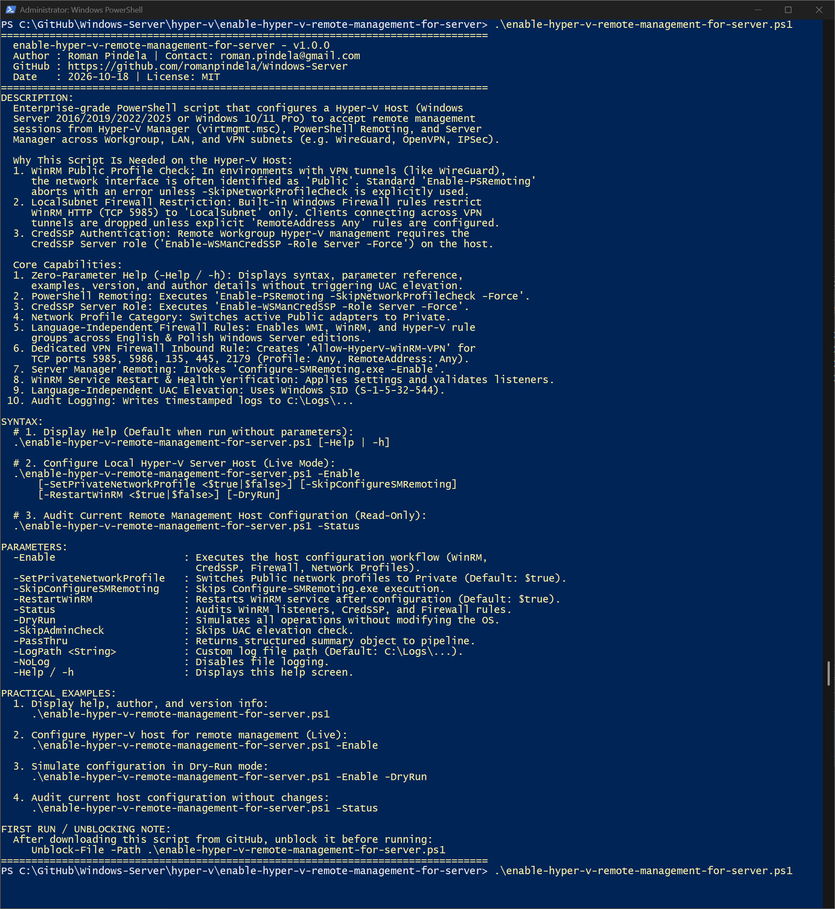
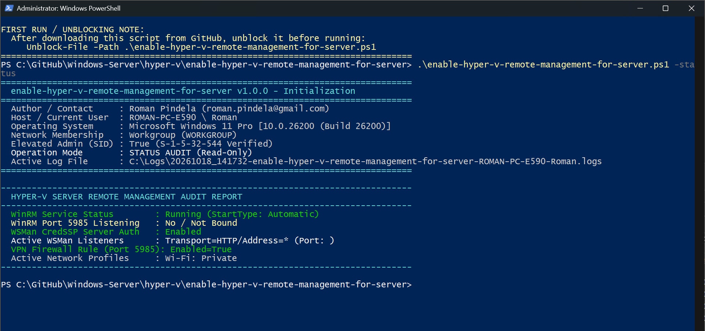

# Enable Hyper-V Remote Management for Server (`enable-hyper-v-remote-management-for-server`)

**Version:** 1.0.0  
**Release Date:** 2026-10-18  
**Author:** Roman Pindela  
**License:** MIT  

An enterprise-grade, clean-code PowerShell automation tool that configures a **Windows Server** (or Windows 10/11 Pro) Hyper-V host for remote management via **Hyper-V Manager (`virtmgmt.msc`)**, **PowerShell Remoting**, and **Server Manager** in a **Workgroup (non-domain) or LAN/VPN environment** (supporting WireGuard, OpenVPN, IPSec, etc., across English and Polish Windows editions).

---

## 📋 Project Information

| Parameter | Value |
| :--- | :--- |
| **Project Name** | Enable Hyper-V Remote Management for Server |
| **Script Name** | `enable-hyper-v-remote-management-for-server.ps1` |
| **Author** | Roman Pindela |
| **Email** | [roman.pindela@gmail.com](mailto:roman.pindela@gmail.com) |
| **GitHub** | [https://github.com/romanpindela/Windows-Server](https://github.com/romanpindela/Windows-Server) |
| **Version** | 1.0.0 |
| **Release Date** | 2026-10-18 |
| **License** | MIT |

---

## 🚀 Overview & Problem Statement

When managing standalone Hyper-V hosts in a **Workgroup** (without Active Directory / Kerberos) across a **VPN tunnel (such as WireGuard, OpenVPN, or IPSec)**, default Windows Server configurations prevent remote connections due to three major hurdles:

1. **WinRM Public Network Profile Block:**
   VPN adapters (such as `rpindela.wireguard`) are frequently classified by Windows as `Public`. Standard `Enable-PSRemoting -Force` aborts immediately with an error:
   > *"WinRM firewall exception will not work since one of the network connection types on this machine is set to Public."*  
   This script executes `Enable-PSRemoting -SkipNetworkProfileCheck -Force` to ensure the listener is created regardless of interface profile state.

2. **Windows Firewall `LocalSubnet` Restriction:**
   Default Windows Firewall rules for WinRM (port `5985`) restrict inbound traffic to `LocalSubnet` only. Because clients on a VPN tunnel connect from a different IP subnet, their packets are dropped by default with connection timeout errors:
   > *"WinRM cannot complete the operation... By default, the WinRM firewall exception for public profiles limits access to remote computers within the same local subnet."*  
   This script provisions an explicit inbound firewall rule (`Allow-HyperV-WinRM-VPN`) opening TCP ports `5985`, `5986`, `135`, `445`, and `2179` across all network profiles and any remote subnet.

3. **CredSSP Server Role Prerequisite:**
   Workgroup Hyper-V management requires delegating credentials via CredSSP. The server must be configured with `Enable-WSManCredSSP -Role Server -Force`.

---

## 🌟 Key Features

* **Zero-Parameter Interactive Help:** Running `.\enable-hyper-v-remote-management-for-server.ps1` without parameters displays full usage documentation, syntax, practical examples, version (`1.0.0`), and author details without triggering UAC elevation.
* **Skip Network Profile Check (`-SkipNetworkProfileCheck`):** Enables WinRM even when virtual or VPN network adapters are marked as `Public`.
* **Network Profile Hardening (`-SetPrivateNetworkProfile`):** Automatically switches active `Public` network profiles to `Private`.
* **Dedicated Multi-Port VPN Firewall Rule:** Creates `Allow-HyperV-WinRM-VPN` allowing:
  * **TCP 5985** (WinRM HTTP)
  * **TCP 5986** (WinRM HTTPS)
  * **TCP 135** (RPC/DCOM Endpoint Mapper)
  * **TCP 445** (SMB / Named Pipes)
  * **TCP 2179** (Hyper-V VMConnect Virtual Machine Console)
* **Language-Independent Firewall Rule Groups:** Automatically enables rules across English and Polish Windows Server editions (`Windows Management Instrumentation (WMI)` / `Instrumentacja zarządzania systemu Windows`, `Windows Remote Management` / `Zdalne zarządzanie systemem Windows`, `Hyper-V Management Clients` / `Klienci zarządzania funkcji Hyper-V`).
* **Server Manager Remoting:** Enables `Configure-SMRemoting.exe -Enable` on Windows Server editions.
* **Non-Destructive Audit Mode (`-Status`):** Audits current WinRM service state, active listeners, CredSSP authentication, network profiles, and firewall rules without making changes.
* **Dry-Run Mode (`-DryRun`):** Simulates all operations safely without modifying the operating system.
* **Language-Independent UAC Auto-Elevation:** Validates Administrator privileges using the Windows Security Identifier (`S-1-5-32-544` / `BuiltInAdministratorsSid`), ensuring compatibility across Polish (`Administratorzy`) and English (`Administrators`) systems.
* **Enterprise Audit Logging:** Automatically logs all operations with UTF-8 timestamps to `C:\Logs\<yyyyMMdd_HHmmss>-enable-hyper-v-remote-management-for-server-<ComputerName>-<UserName>.logs`.

---

## 🛠️ Usage & Examples

### Unblocking the Script After Download
When downloading the script from GitHub, unblock it before execution:
```powershell
Unblock-File -Path .\enable-hyper-v-remote-management-for-server.ps1
```

### 1. Display Help & Syntax (Zero-Parameter Run)
```powershell
.\enable-hyper-v-remote-management-for-server.ps1
```

### 2. Configure Local Hyper-V Server Host (Live Mode)
```powershell
.\enable-hyper-v-remote-management-for-server.ps1 -Enable
```

### 3. Audit Current Remote Management Host Configuration (Read-Only)
```powershell
.\enable-hyper-v-remote-management-for-server.ps1 -Status
```

### 4. Simulate Host Configuration in Dry-Run Mode
```powershell
.\enable-hyper-v-remote-management-for-server.ps1 -Enable -DryRun
```

---

## 🔄 Client-Server Architecture Workflow

```
+-------------------------------------------------------------+
| CLIENT WORKSTATION (Windows 10/11)                          |
| Script: enable-hyper-v-remote-management.ps1                |
| - Hosts file: '10.10.1.10  SERWER'                          |
| - WinRM TrustedHosts: 'SERWER, 10.10.1.10'                  |
| - CredSSP Client: wsman/SERWER                              |
| - GPO Delegation: AllowFreshCredentialsWhenNTLMOnly         |
+-------------------------------------------------------------+
                              │
                              │ [WireGuard VPN Tunnel: TCP 5985, 135, 2179]
                              ▼
+-------------------------------------------------------------+
| HYPER-V HOST SERVER (Windows Server / SERWER)               |
| Script: enable-hyper-v-remote-management-for-server.ps1     |
| - WinRM HTTP Listener: Port 5985 (SkipNetworkProfileCheck)  |
| - CredSSP Server Role: Enabled                              |
| - Firewall Rule: Allow-HyperV-WinRM-VPN (Any RemoteAddress) |
| - Network Profile: Private                                  |
| - Configure-SMRemoting: Enabled                             |
+-------------------------------------------------------------+
```

---

## 📸 Screenshots

### 1. Live Configuration (`-Enable`)
Executing the complete automated configuration on the Hyper-V host (WinRM listener, CredSSP server role, network profile hardening, dedicated VPN firewall rules, and WinRM service restart):



### 2. Diagnostic & Audit Mode (`-Status`)
Read-only inspection of the active Hyper-V host state (WinRM service, Port 5985 listener status, CredSSP server authentication, and VPN firewall rule):



---

## 📄 License

This project is licensed under the [MIT License](LICENSE).
